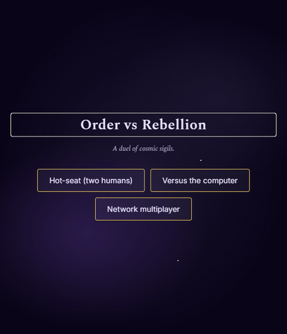

# Tic-Tac-Toe — Order vs Rebellion

A space-opera-themed tic-tac-toe in three flavours: a colorful terminal version, an installable single-player web app, and a Blazor Server multiplayer app.
All three share a single C# game engine.

<p align="center">
  
</p>

<p align="center">
  <a href="https://tictactoe.derbysquad.info/"><strong>▶ Play it live →</strong></a>
</p>

| | Console | Web (single-player) | Web Multiplayer |
|---|---|---|---|
| What it is | An ANSI-colored terminal game. | A Blazor WebAssembly Progressive Web App. Installable on desktop & mobile. Plays offline. | A Blazor Server app: hot-seat + vs CPU + auto-named multiplayer lobby. |
| Where it runs | Anywhere a .NET 9 console can run. | Any modern browser; or installed as a PWA. | Any Linux/Mac/Windows host with .NET 9; behind your reverse proxy of choice. |
| Best for | Quick game in a terminal. | Solo play, mobile-friendly, offline-capable. | Playing with someone on another device. |

The theme is **The Ascendant ☼ vs The Crimson Vanguard ✦** — original names and symbols, no trademarked content.
Three AI difficulty tiers: **Recruit** (random) / **Captain** (one-ply tactical) / **Warlord** (perfect minimax — never loses).

## Quick start

You need **.NET 9 SDK** ([download](https://dotnet.microsoft.com/download)) and that's it. The repo has no other native or system dependencies.

```bash
git clone <this-repo>
cd tic-tac-toe-game

# play in the terminal
dotnet run --project console

# play in a browser, single-player (PWA)
dotnet run --project web
# → open the URL it prints (default http://localhost:5089)

# multiplayer + local modes (Blazor Server)
dotnet run --project web-multiplayer --urls http://localhost:5050
# → open http://localhost:5050 in two windows to test multiplayer
```

The single-player web app is a PWA — when served over HTTPS, your browser will offer to install it as a desktop or home-screen app.

## Repo layout

```
tic-tac-toe-game/
├── core/                    Shared C# class library (Board, Ai, ThemeText, enums)
├── console/                 Terminal UI (ANSI rendering + smoke tests)
├── web/                     Single-player Blazor WebAssembly PWA
├── web-multiplayer/         Blazor Server app (hot-seat + vs CPU + network multiplayer)
├── tools/icon-gen/          Standalone tool that re-generates the placeholder PWA icons
├── docs/superpowers/        Design specs, implementation plans, screenshots
└── TicTacToe.sln            Solution file tying everything together
```

`core/` is the single source of truth for game logic — all three UI surfaces consume it.

## Smoke checklist

The console version has a 10-scenario regression checklist (`console/tests/smoke.ps1`) covering wins, draws, AI difficulty, error handling, and the deterministic `TICTACTOE_SEED` mode. Run any time:

```powershell
pwsh -File console/tests/smoke.ps1
```

The single-player web app's verification is currently manual — open it in a browser and play.

For multiplayer security checks, run this from the repository root with
PowerShell 7 and the .NET 9 SDK installed:

```powershell
pwsh -File ./test-multiplayer.ps1
```

The command starts its own temporary local test server, checks reconnects and
forfeit authorization, and returns a failure status if any check fails. There
is no need to start the app or arrange another player. Use `-Repeat 10` to repeat
the checks when investigating intermittent failures. Test reports are saved in
`artifacts/test-results/`; GitHub runs the same checks on pull requests.

See [the multiplayer testing guide](web-multiplayer/README.md#testing-multiplayer)
for the local two-player playtest.

## Replacing the placeholder art

The web build ships with placeholder SVG sigils and procedurally-generated PNG icons. Drop replacements in `web/wwwroot/img/` and `web/wwwroot/img/icons/` matching the names listed in `web/wwwroot/img/README.md`, then re-publish (`dotnet publish web -c Release`).

## License

Currently proprietary — all rights reserved. See [LICENSE](LICENSE). The author may release this code under an open-source license at a later date.
